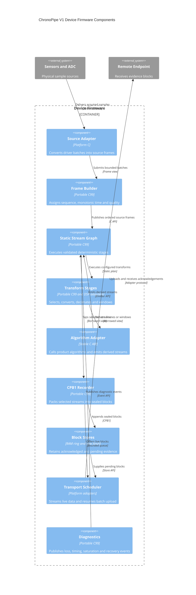

# Device runtime components

Legend: components are linked modules inside Device Firmware. Source, graph, transforms,
and algorithms form the real-time data plane; recorder, store, and transport form the
evidence I/O plane connected through fixed block ownership.
